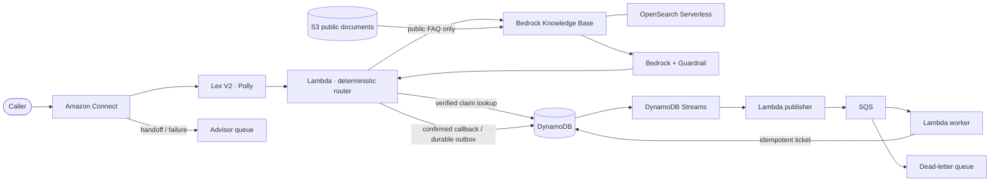

# AWS Voice Agent

[](https://github.com/meligavincent/aws-voice-agent/actions/workflows/ci.yml)


**An insurance service agent that checks claim progress, records confirmed callback requests and answers public service questions — with a human escape route.**

A runnable engineering portfolio: application code, AWS infrastructure, a real LocalStack integration test, failure tests and operational documentation. Built by [meligavincent](https://github.com/meligavincent).

**Validation boundary:** the local Lambda → DynamoDB Streams → SQS → Lambda path has been exercised. Terraform plans and CloudFormation templates are checked automatically. Telephony, Bedrock, IAM enforcement and regional recovery require acceptance tests in your AWS account. This repository does not claim a historical production deployment or measured customer results.

[Quickstart in French](docs/quickstart-fr.md) · [Deploy to AWS](docs/aws-deployment.md) · [Architecture](docs/architecture.md) · [Operations](docs/operations.md) · [Security](docs/security.md)

## The problem and the implemented behavior

Routine claim-status calls occupy advisors while callers repeatedly explain the same request. The agent handles a deliberately bounded part of that journey:

| Caller request | Implementation | Failure behavior |
|---|---|---|
| “Where is my claim?” | Six-digit demo access check, then an exact status/missing-document/next-step template from DynamoDB. No LLM in this path. | Generic denial and advisor handoff; no existence disclosure. |
| “Please call me back.” | Explicit confirmation, durable outbox, asynchronous creation of one callback ticket per claim/session. | Retry and reconciliation; ticket creation is idempotent. |
| “What are your opening hours?” | Public documents → Bedrock Knowledge Base → bounded answer with a published guardrail version. | Missing context, blocked output or dependency failure → advisor. |
| “I want a person.” | Amazon Connect advisor queue during business hours; unavailable message when the flow cannot transfer. | Queue must be staffed and tested before launch. |

A callback **ticket is not an outbound call**. The repository owns a small demonstration claim store; it does not silently assume a connection to an insurer's CRM. There are no coverage decisions, payment actions or invented performance results.

## Run it locally

Prerequisites: Python 3.12, [uv](https://docs.astral.sh/uv/), Terraform ≥1.10, Docker Engine with Compose, and enough memory for LocalStack plus Lambda containers. The reference environment uses Terraform 1.16.1 and uv 0.9.3.

```bash
git clone https://github.com/meligavincent/aws-voice-agent.git
cd aws-voice-agent
make setup
make local-up local-apply
make demo
make integration
```

The Makefile uses Docker's `default` context. Override with `DOCKER_CONTEXT=your-context` if appropriate. Port 4566 must be free; do not replace another running LocalStack instance without checking its data. No real AWS credentials are needed. The local provider uses explicit localhost endpoints and dummy credentials.

Example of the implemented demonstration:

```text
Votre dossier est au statut : en cours d’examen. Pièces attendues : constat signé.
Souhaitez-vous que je crée une demande de rappel pour ce dossier ?
Votre demande de rappel est enregistrée. Aucun délai de rappel ne peut être garanti ici.
PASS: Lambda → DynamoDB outbox → Streams → Lambda → SQS → Lambda → one callback ticket
```

Fictitious claim: `123456`; demo access code: `654321`. Local FAQ inference is an explicitly labelled stub; LocalStack does not prove speech recognition or Bedrock quality. See [local coverage and troubleshooting](docs/local-development.md).

## Architecture in the code



Single-region deployment is the default. An optional second regional application uses a DynamoDB Global Table and S3 replication; each region has its own RAG index. **Two regional applications do not automatically enable Connect Global Resiliency.** Its AWS support, instance pairing and telephony requirements are documented separately.

[View the animated target architecture (English)](docs/assets/target-architecture.gif) · [GIF français](docs/assets/architecture-cible-fr.gif). These design GIFs include a target AWS-native delivery pipeline and Global Resiliency. The implementation currently uses GitHub Actions for verification and an operator-run Terraform deployment. See the [diagram-to-code mapping](docs/architecture.md#diagram-to-code-mapping).

## What to inspect

- [Business router](src/voice_agent/service.py): deterministic private-data access separated from generative answers.
- [Durable actions](src/voice_agent/store.py): conditional writes, duplicate delivery handling and recovery after a partial write.
- [Failure tests](tests/unit/test_resilience.py): replay, expired operations, region ownership and partial-batch failures.
- [Infrastructure](infra/modules/regional): scoped execution roles, encryption, bounded concurrency, alarms and versioned Lambda aliases.
- [Architecture decisions](docs/decisions.md): why managed services, why an outbox, why active/passive and where the design stops.
- [LLMOps evaluation](docs/evaluation.md): versioned behavior cases, prompt/guardrail lifecycle and the distinction between deterministic tests and real model evaluation.

## Verification and deployment

```bash
make check validate
terraform -chdir=infra/aws test
```

CI runs Python quality and behavior tests, CloudFormation linting, Terraform validation, mocked one/two-region plans, and the LocalStack Lambda integration test. Runtime Python dependencies and Terraform providers are locked. Lambda ZIPs vendor the runtime SDK and use deterministic timestamps.

For AWS, start with the [deployment guide](docs/aws-deployment.md). Configure an AWS account/profile, deployment principal, regional model access, a phone number and the advisor routing setup. Terraform creates the application resources; the guide includes ingestion, phone association, real Lex smoke tests and the release acceptance steps. No AWS deployment runs merely because code is pushed to this public repository.

## Documentation

| Guide | Contents |
|---|---|
| [AWS deployment](docs/aws-deployment.md) | State bootstrap, account isolation, prerequisites, apply, ingestion, phone setup, acceptance and cleanup |
| [Local development](docs/local-development.md) | Reproducible demo, actual test coverage, emulator limitations and resets |
| [Architecture](docs/architecture.md) | Data paths, deployment boundaries, region behavior and GIF mapping |
| [Operations](docs/operations.md) | Failure modes, replay, disaster recovery, rollback and runbooks |
| [Security](docs/security.md) | Threat model, demo authentication limits, IAM, privacy and retention |
| [Evaluation](docs/evaluation.md) | LLMOps scope, policy fixtures and live evaluation protocol |
| [Cost and sustainability](docs/cost-and-sustainability.md) | Service cost drivers, bounded generation, capacity and retention trade-offs |
| [Decisions](docs/decisions.md) | Concise architecture decision records |
| [Validation record](docs/validation.md) | What was observed and what still needs an AWS account |

MIT license for the code. AWS artwork and third-party dependencies retain their own terms; see [third-party notices](THIRD_PARTY_NOTICES.md).
